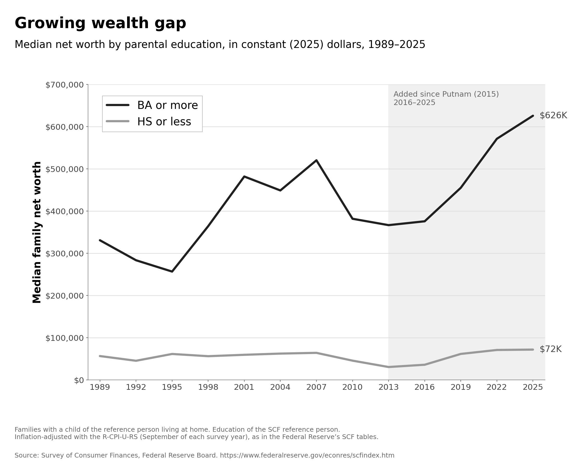

# Growing wealth gap — POLISCI 158 figure reproduction

This reproduces the supplied course figure, **Growing wealth gap**: median family net worth by parental education, 1989–2025, in constant 2025 dollars.



## Original data and method

Source: [Federal Reserve Board, Survey of Consumer Finances](https://www.federalreserve.gov/econres/scfindex.htm). `get_data.py` downloads the original summary-extract CSV ZIP files for each survey from 1989 through 2025 directly from the Federal Reserve, plus its variable-definition program. The downloaded extracts already express net worth in 2025 dollars; the script does not apply a second inflation adjustment. Download URLs and SHA-256 hashes are saved in `data/sources.json`.

`plot.py` selects families with `KIDS > 0`. Education refers to the SCF reference person: `EDCL = 4` is BA or more; `EDCL = 1 or 2` is high school or less. Families with some college/associate degrees (`EDCL = 3`) are excluded. Children are identified by household relationship, with no additional under-18 age restriction.

The median uses `NETWORTH` and survey weight `WGT`, pooling the five imputation records per family and dividing their weights by five. It is the first observed net-worth value where cumulative weight reaches half the group total. This is a pooled weighted median, not an average of five separate medians. No confidence intervals are estimated. The Federal Reserve's extracts handle the R-CPI-U-RS inflation adjustment. Consult the downloaded `bulletin.macro.txt` for variable definitions.

## Run

Requires Python 3.9+, curl, and Matplotlib:

```bash
python -m pip install -r requirements.txt
python get_data.py
python plot.py
```

Run from any directory; paths are relative to the scripts. To download fresh copies, run `python get_data.py --refresh`. `plot.py` creates `figure.png` and the calculated table `medians.csv`. Large raw downloads are omitted from this package and ignored by Git; the script recreates them.

## Comparison with the original

The reproduction preserves the two grayscale lines, survey-year ticks, dollar axis, legend, and shaded post-2013 region labelled “Added since Putnam (2015), 2016–2025.” The major peaks and troughs visually match the supplied figure. Calculated 2025 medians are **$625,800** for BA or more and **$71,790** for HS or less, giving the same rounded endpoint labels, **$626K** and **$72K**. Fonts and spacing differ slightly. Exact point-by-point numerical agreement cannot be established from the reference image alone; its underlying plotting table was not supplied. No plotted values were typed in or extracted from image pixels.

## Submit

Create a GitHub repository named `ps158-reproduce`. Upload this folder's contents so that `get_data.py`, `plot.py`, `figure.png`, and `README.md` appear directly on the repository's main page. Then submit `https://github.com/YOUR-USERNAME/ps158-reproduce` on Canvas. Use a public repository, or arrange private-repository access with your TA before submitting.
